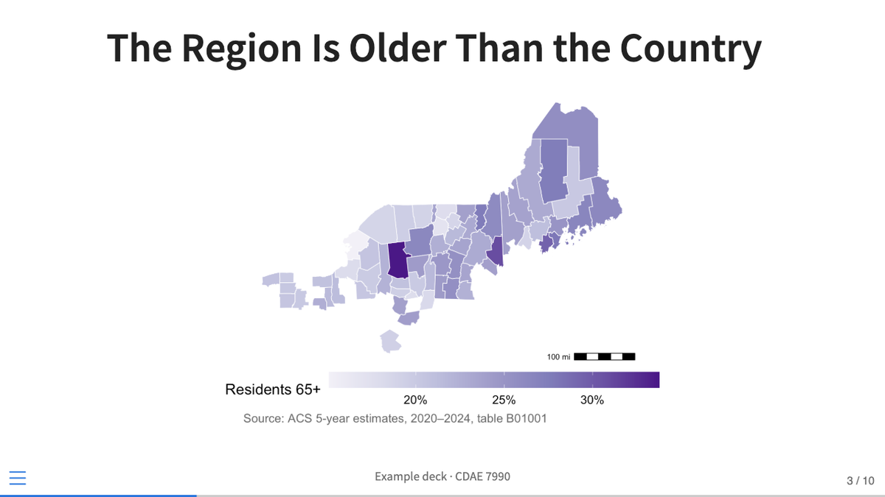
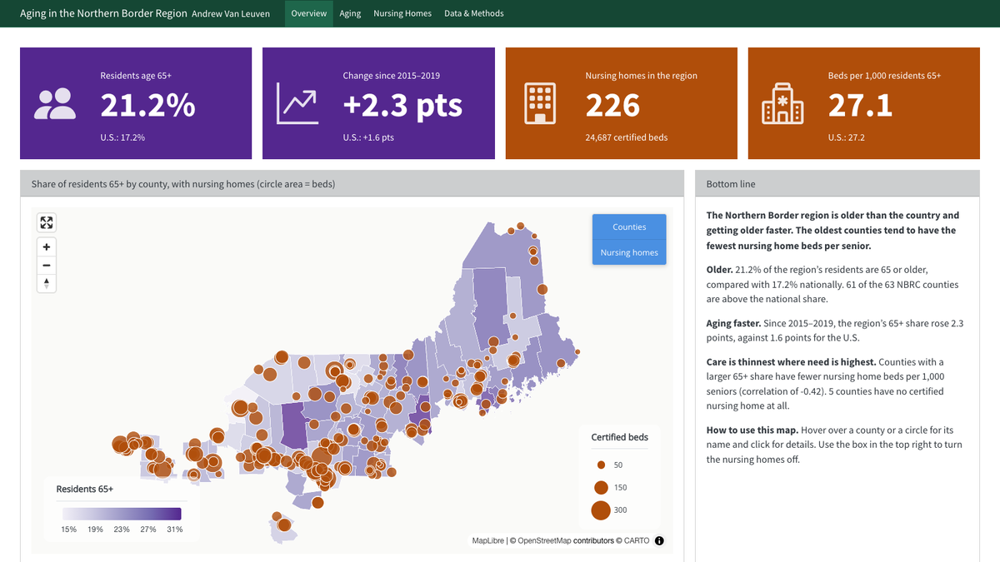

Your final NBRC deliverable is a **slide deck** or a **dashboard**, your team's choice. These two examples show what a finished version of each can look like. Both tell the same story with the same data: aging and nursing homes across the 63 NBRC counties, a topic picked so it doesn't overlap with either team's domain. Click a preview to open it.

::: {.grid}

::: {.g-col-12 .g-col-md-6}
### Slide deck

[{.border .rounded fig-alt="Preview of a slide titled 'The Region Is Older Than the Country' with a county map of the share of residents 65 and older"}](nbrc_aging_slides.qmd)

[Open the slide deck](nbrc_aging_slides.qmd) · [Read the code](https://github.com/andrewvanleuven/uvm_datasci/blob/main/examples/nbrc_aging_slides.qmd)

Press **S** while viewing it to open the speaker notes.
:::

::: {.g-col-12 .g-col-md-6}
### Dashboard

[{.border .rounded fig-alt="Preview of the dashboard's overview page: four value boxes above an interactive map of counties and nursing homes, with a bottom-line summary at the right"}](nbrc_aging_dashboard.qmd)

[Open the dashboard](nbrc_aging_dashboard.qmd) · [Read the code](https://github.com/andrewvanleuven/uvm_datasci/blob/main/examples/nbrc_aging_dashboard.qmd)

Use the tabs along the top to move between pages.
:::

:::

---

## Slide Deck or Dashboard?

### A slide deck

A slide deck is a strung-together collection of visualizations that requires the presenter to tell a story. You decide the order, so you can build an argument one step at a time: the bottom line first, then one finding per slide, then what it means for NBRC. Each slide title states its finding, and the figure underneath is the evidence. What connects the slides is *you*. In the example, that narration lives in the speaker notes, which is a good habit for your own deck: the notes are the story you'll tell in Montpelier.

### A dashboard

A dashboard has no presenter, so it has to tell the story on its own. Readers choose where to look and in what order, which means the most important numbers go at the top, every card's title states its finding, and the details sit one hover or click away. A dashboard is something NBRC staff can come back to after we leave and explore for themselves, for example by looking up their own county. You'll still present it on December 17, but it also has to make sense to someone who never heard your presentation.

|  | Slide deck | Dashboard |
|---|---|---|
| **Who tells the story?** | You, the presenter | The page itself |
| **Who picks the order?** | You do, one slide at a time | The reader does |
| **Best for** | Making an argument to a room | A reference people come back to |
| **Where the details go** | Speaker notes and a data slide at the end | Hover text, popups, and a data page |
| **YAML** | `format: revealjs` | `format: dashboard` |

---

## How Hard Is the Code?

**The slide deck uses only code from class:** `get_acs()` from Week 9, `dplyr` and `pivot_wider()` from Weeks 2–3, `ggplot2` from Weeks 4–7 (the dumbbell is the Week 7 recipe), and `st_as_sf()`, `st_join()`, and scale bars from Week 10 and HW4.

**The dashboard is mostly the same code** in the dashboard layout from Week 8. It adds four new pieces, each marked `NEW:` in the source:

- **Value boxes**, the colored number tiles: a `::: {.valuebox}` block with a title, a number, and an optional line underneath
- **The interactive map**: the long version of `maplibre_view()` from Week 10, with two layers, legends, and click-for-details popups
- **The searchable table**: `reactable()`, which needs `install.packages("reactable")` once
- **Styling** in a small `dashboard.scss` file, which is optional and safe to skip

Both files start by explaining what's in them, and the comments walk through each step. The nursing home data is a CSV saved in [examples/data/](https://github.com/andrewvanleuven/uvm_datasci/tree/main/examples/data), and the Census data comes from your own API key, the same way as in HW4.
