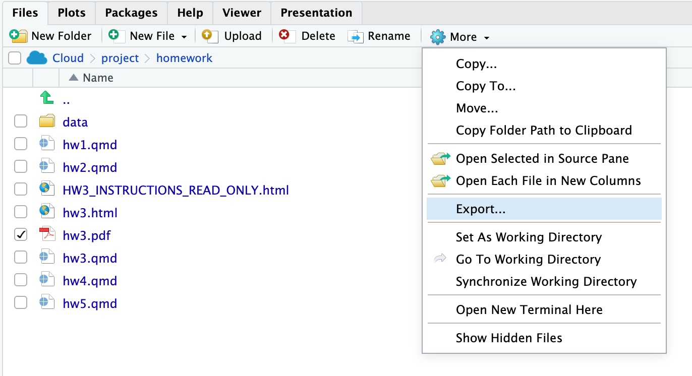

<!-- Keep the install and get_education_data() code in sync with the
     "Installing a Package from GitHub" and "Colleges as Points" slides in
     slides/week10.qmd. (This assignment was briefly called HW5.) -->

::: {.callout-note}
This page is just instructions. **All of your work goes in `homework/hw4.qmd`** in your [Posit Cloud workspace](https://posit.cloud/spaces/738679/content/12820277), and it's fine to replace everything in that file.
:::

HW4 is two maps of **one NBRC state**: a choropleth of Census data, and a point map of the state's colleges and universities. The [Week 9](../slides/week09.html) and [Week 10](../slides/week10.html) slides have code for nearly every step.

## Get the File

Open the **Terminal** tab (next to Console) and run this one line:

```bash
git fetch && git checkout origin/main -- homework/hw4.qmd && rm -f homework/hw5.qmd
```

This brings in a blank `hw4.qmd` starter and removes the old `hw5.qmd`, which you won't need.

## Before You Start

- Your **Census API key** should already be installed from Week 9. In the Console, `Sys.getenv("CENSUS_API_KEY")` should print it. If it prints `""`, go back to the "Install Your Census API Key" slide in [Week 9](../slides/week09.html).
- Pick **one state**: Maine, New Hampshire, New York, or Vermont. Use the same state for both parts.
- Put the `library()` calls you need in a chunk at the top of `hw4.qmd`

## Part 1: A Choropleth of Census Data

1. Pick **one ACS variable** that fits your team's domain area (or is simply just interesting to you). The Week 9 "Your Turn" slide has starting points.
2. Pull it with `get_acs()` for your state, with `geometry = TRUE`. Counties or county subdivisions (towns) are both fine.
3. Map a **share, rate, or median**, not a raw count. If your variable is a count, divide it by the table's total line.
4. Your map needs:

    - a readable palette (`scale_fill_distiller()`, `scale_fill_viridis_c()`, or similar), with formatted legend labels such as `scales::label_percent()`
    - `theme_void()`
    - a **title that states what you see**, not just the variable name
    - a **caption** that names the source and the table (for example, "Source: 2020-2024 ACS 5-year estimates, table B25070")
    - a **scale bar**, from the `ggspatial` package:

    ```r
    library(ggspatial)

    ggplot(your_data) +
      geom_sf(aes(fill = your_share)) +
      annotation_scale(location = "bl", unit_category = "imperial") # adds the scale bar
    ```

    **The last line adds the scale bar.** Add it (and the `+` before it) to the end of your own map code.

    A north arrow (`annotation_north_arrow()`) is optional.

5. Under the map, write **two or three sentences** about what it shows. Include at least one specific number (a place and its value).

## Part 2: Colleges as Points

1.  **Install the `educationdata` package from GitHub.** Run these two lines **once, in the Console**, not in `hw4.qmd`. (If they were in your `.qmd`, they'd reinstall the package every time you render.)

    ```r
    install.packages("remotes")
    remotes::install_github("UrbanInstitute/education-data-package-r",
                            upgrade = "never")
    ```

2.  **Pull your state's colleges.** This code goes in `hw4.qmd`. Change `fips = 50` to your state's FIPS code: Maine is `23`, New Hampshire `33`, New York `36`, and Vermont `50`.

    ```r
    library(educationdata)

    colleges <- get_education_data(
      level = "college-university",
      source = "ipeds",
      topic = "directory",
      filters = list(year = 2024, fips = 50)
    ) |>
      filter(currently_active_ipeds == 1, sector > 0)
    ```

    The `filter()` drops administrative offices (such as a state college system's central office) and institutions that have closed or merged. This is the federal **IPEDS** directory, served by the Urban Institute's Education Data Portal.

3.  **Turn the table into points** with `st_as_sf()`, the same way we did with airports in Week 10:

    ```r
    colleges_sf <- colleges |>
      st_as_sf(coords = c("longitude", "latitude"), crs = 4326)
    ```

4.  **Map the points** on top of your state's county boundaries (`counties("VT", cb = TRUE)`, with your state) or on top of your Part 1 map. Give it a title that states what you see and a caption naming the source: "Source: IPEDS, via the Urban Institute's Education Data Portal."

5.  *Optional*: color the points by `inst_control`, which is `1` for public, `2` for private nonprofit, and `3` for private for-profit. Turn it into labels first:

    ```r
    mutate(control = case_when(
      inst_control == 1 ~ "Public",
      inst_control == 2 ~ "Private nonprofit",
      inst_control == 3 ~ "Private for-profit"
    ))
    ```

6.  Under the map, write **two or three sentences**: Where are your state's colleges concentrated, and where are the gaps?

::: {.callout-tip title="One point per institution, not per campus"}
IPEDS lists each institution once, at its main address. Vermont State University has several campuses but appears as a single point in Randolph, and the Community College of Vermont appears once, in Montpelier. Keep that in mind when you write about gaps.
:::

## Render

Render `hw4.qmd` to HTML with the **Render** button, or in the **Terminal** tab:

```bash
quarto render homework/hw4.qmd
```

`hw4.html` should appear in your `homework` folder. Open it and check that both maps are there.

## Turn It In: Email Me the HTML File

::: {.callout-important title="Send the file itself, not a link"}
A link to your Posit Cloud project only works for you, so download `hw4.html` and attach it to an email.

1. In the **Files** pane, open the `homework` folder and check the box next to **`hw4.html`**
2. Click **More** (the gear icon) and choose **Export...**
3. Click **Download**. The file saves to your computer's Downloads folder.
4. Attach `hw4.html` to an email to me by **Sunday, Nov. 15, 11:59pm**

{fig-alt="The Posit Cloud Files pane with a file checked and the More menu open, with Export... highlighted"}
:::

## Checklist

- [ ] One NBRC state, the same one for both parts
- [ ] Part 1: a share, rate, or median, with a readable palette, `theme_void()`, a title that states the finding, a source caption, and a scale bar
- [ ] Part 2: colleges as points over your state, with a title and a source caption
- [ ] Two or three sentences under each map
- [ ] `hw4.qmd` renders to HTML without errors
- [ ] `hw4.html` downloaded with **More → Export...** and emailed to me as an attachment (not a link)
