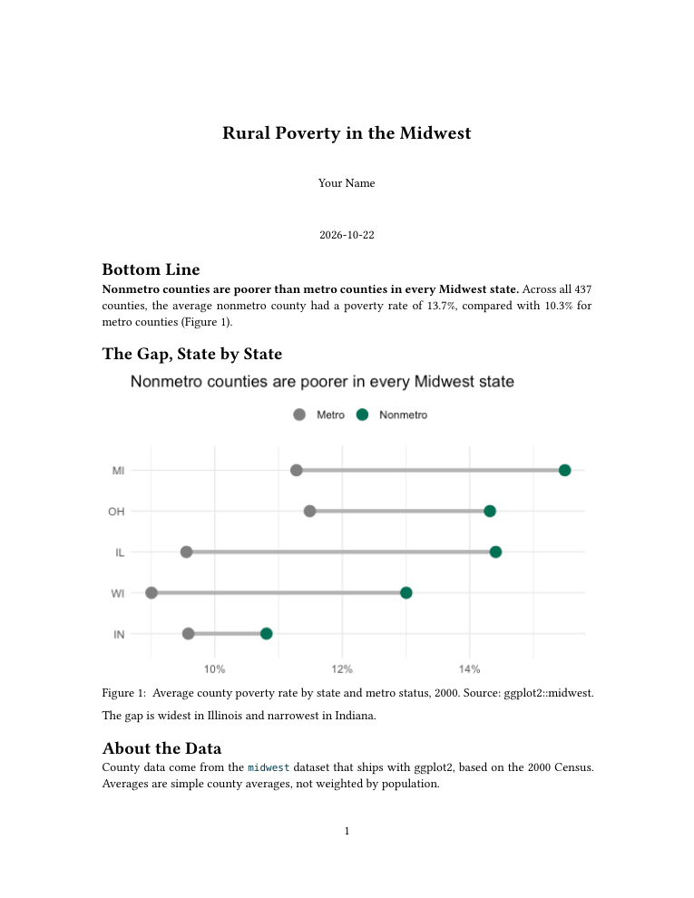

<!-- Self-guided week: the slides are the students' follow-along guide, and the speaker notes (press S) are the script for the recorded video. -->

```{=html}
<style>
/* Wrap long prose lines in the Markdown example blocks; R code keeps its own line breaks. */
.reveal pre.markdown code { white-space: pre-wrap; }
</style>
```

```{r}
#| include: false
library(tidyverse)
options(pillar.print_max = 5, pillar.print_min = 5, width = 72)
wide_margin <- theme(plot.margin = margin(5.5, 22, 5.5, 5.5))
theme_set(theme_gray(base_size = 16) + wide_margin)
knitr::opts_chunk$set(fig.width = 8, fig.height = 4.5, fig.align = "center",
                      dpi = 150, out.width = "85%")
theme_minimal <- function(base_size = 16, ...) ggplot2::theme_minimal(base_size = base_size, ...) + wide_margin
```

## Welcome to an Asynchronous Week

- I'm at Purdue today, so this week is a recorded video plus these slides
- The slides double as your **follow-along guide**. Hover over any code block and click the clipboard icon to copy it into Posit Cloud.
- Pause the video whenever you want to type along or try something
- By the end, **the first half of HW3 will be done**: a short report, rendered to both a web page and a PDF. You'll also know how to render your team's charter.

::: {.notes}
Hi everyone. As you know, I'm at Purdue this week giving a seminar, so instead of meeting in Morrill we're doing this one asynchronously. You're watching a video of me walking through these slides, and the slides themselves are on the course website, so you can go back to them any time. Every code block on these slides has a little clipboard icon in the corner when you hover over it, so you never have to retype anything from the video. I'd really encourage you to have Posit Cloud open in another window and follow along. Pause me whenever you need to. And here's the good news: we're going to build the first half of HW3 together, right here in the video. By the end, you'll have a short report in Quarto, rendered to both HTML and PDF, which is exactly the skill you need for your team charter this weekend.
:::

## This Week's Plan

- **Part 1: Anatomy of a Quarto document.** We'll build the first half of HW3 together.
- **Part 2: One source, many formats.** HTML, PDF, slides, and dashboards.
- **Part 3: Storytelling with data.** Turning analysis into something NBRC will read.
- **Part 4: A short git primer.** What the homework command you've been running actually does.
- **Then**: the rest of HW3 (two more things) and your Scope & Team Charter

::: {.notes}
Here's the plan. Four parts. First, we'll open up a Quarto document and look at what's actually inside it, and we'll build one together from scratch. That document is the first half of HW3. Second, we'll see how that same file can become a web page, a PDF, a slide deck, or a dashboard by changing one line. Third, and this is the part I care most about, we'll talk about storytelling: how to turn analysis into something a busy person at NBRC will actually read. And fourth, a short git primer, mostly so you understand the command you've been running in the Terminal to get each homework. Then I'll wrap up with the second half of HW3 and what's due.
:::

## Coming Up {.smaller}

| When | What |
|---|---|
| **Sun. Oct. 25**, 11:59pm | **Scope & Team Charter due**: rendered to PDF, one copy emailed to me per team |
| **Thu. Oct. 29** | Back in person (Morrill 005): intro to GIS, Census data, and choropleth maps |
| **Sun. Nov. 1**, 11:59pm | **HW3 due** (released today, and you'll start it during this video) |

: {tbl-colwidths="[30,70]"}

::: {.notes}
Quick look at the calendar. Your Scope and Team Charter is due this Sunday, October 25th, at 11:59pm. One PDF per team, emailed to me by one person. We'll cover exactly how to make that PDF in a few minutes. Next Thursday we're back in person in Morrill 005 and we start maps. And HW3 is released today and due Sunday, November 1st. You'll do the first half of it with me in this video, and the second half is just two more things.
:::

# Part 1: Anatomy of a Quarto Document {background-color="#007155"}

## You've Been Using Quarto All Semester

- Every homework has been a `.qmd` file, and **Render** turned it into HTML
- These slides are a `.qmd` file. So is the course website.
- Quarto takes **one plain-text file** and turns it into a document, a PDF, a slide deck, a website, or a dashboard
- Today: what's inside the file, so you can make it do what you want

::: {.notes}
You've actually been using Quarto since the first week. Every homework is a .qmd file, and when you click Render, Quarto turns it into an HTML page. These slides are a .qmd file too, and so is the entire course website. That's the big idea of Quarto: you write one plain-text file with your words and your code, and Quarto turns it into whatever format you need. Your NBRC deliverable will be built this way, so today we're going to slow down and look at what's actually inside one of these files.
:::

## Three Ingredients {.smaller}

````markdown
---
title: "Rural Poverty in the Midwest"
format: html
---

## Bottom Line

Nonmetro counties are **poorer** than metro counties.

```{{r}}
library(tidyverse)
nrow(midwest)
```
````

- **YAML header** (between the two `---` lines): settings for the whole document
- **Markdown text**: your writing, with light formatting
- **Code chunks**: R code that runs when you render, with the results placed into the document

::: {.notes}
Every Quarto document has three ingredients. At the top, between the two lines of three dashes, is the YAML header. That's where settings for the whole document live: the title, the author, the output format. Then there's ordinary text written in Markdown, which is just a light way of adding formatting, like the two asterisks around "poorer" that make it bold. And then there are code chunks, the gray blocks that start with three backticks and r in curly braces. When you render, Quarto runs that code and drops the results right into the document. That's it. Everything else is detail.
:::

## Follow Along: Get HW3 {.smaller}

In Posit Cloud, open the **Terminal** tab (next to Console, *not* the Console itself) and run this one line:

```bash
git fetch && git checkout origin/main -- homework/hw3.qmd
```

- Open `homework/hw3.qmd` from the Files pane. It's nearly empty: a header, plus the instructions in a note at the bottom.
- **Everything we build in Part 1 goes in this file, above that note.** That's the first half of HW3.
- If your editor ever looks like a word processor, flip the **Source / Visual** toggle at the top left back to **Source**
- Starting a brand-new document later, like your charter? **File → New File → Quarto Document…**, then **Create Empty Document**.

::: {.notes}
Let's build one, and let's make it count. Open Posit Cloud, and click the Terminal tab. That's the tab right next to the Console, not the Console itself. Paste in this one line and hit enter. In Part 4 I'll explain exactly what it does. Then open homework/hw3.qmd from the Files pane. It's almost empty. There's a header at the top, and at the bottom there's a note with the instructions, which won't show up in your rendered report. Everything we build together goes above that note, and when we're done, you'll have finished the first half of HW3. One tip: at the top left of the editor there's a toggle between Source and Visual. Visual mode looks like a word processor and hides the raw text. Everything I show you today is in Source mode, so if your screen ever looks different from mine, check that toggle. And for later: when you need a brand-new document, like your team charter, it's File, New File, Quarto Document, and then the Create Empty Document button in the bottom left of that window.
:::

## The YAML Header {.smaller}

```yaml
---
title: "Rural Poverty in the Midwest"
author: "Your Name"
date: today
format: html
execute:
  echo: false
  message: false
  warning: false
---
```

- **YAML** stands for "YAML Ain't Markup Language" (a programmer joke). It's just a format for settings.
- Each line is a `key: value` pair. **Indentation matters**: two spaces means "this belongs to the line above."
- `date: today` fills in the date every time you render
- `execute:` sets chunk options for the whole document. Here, it hides all code, messages, and warnings, because the reader is NBRC and not a programmer.
- A YAML typo is one of the most common reasons a document won't render. When something breaks, check the header first.

::: {.notes}
Replace the header at the top of hw3.qmd with this one, everything between and including the two lines of dashes, and put your own name in. YAML, by the way, stands for "YAML Ain't Markup Language." Yes, the acronym contains itself. Programmers think that's funny. All you need to know is that it's a simple format for settings. Each line is a key, a colon, and a value. Indentation matters a lot in YAML. Notice that echo, message, and warning are indented two spaces under execute. That's how YAML knows they belong to execute. date: today just fills in today's date whenever you render. And the execute section is new: it sets options for every code chunk in the document at once. Here we're saying hide the code, hide the messages, hide the warnings. Why? Because this is a report for a reader who doesn't care about our code. One practical tip: if a document refuses to render, the YAML is the first place to look. A missing space or a stray tab will break it.
:::

## Markdown: Formatting Your Writing {.smallest}

| You type | You get |
|---|---|
| `**bold**` | **bold** |
| `*italic*` | *italic* |
| `## Bottom Line` | a section heading (in a slide deck, a new slide) |
| `- item` | a bulleted list |
| `1. item` | a numbered list |
| `[NBRC](https://www.nbrc.gov)` | a link: [NBRC](https://www.nbrc.gov) |
| `` | an image |
| `` `code` `` | `code` formatting |

: {tbl-colwidths="[40,60]"}

- Leave a **blank line** before every heading and list, or Markdown may not recognize it
- More in the reading: [R4DS: Quarto](https://r4ds.hadley.nz/quarto.html)

::: {.notes}
Markdown is how you format text. Two asterisks for bold, one for italics. Pound signs for headings: two pound signs is a section heading, and in a slide deck it starts a new slide. A dash and a space for a bullet, a number and a period for a numbered list. Square brackets then parentheses for a link. Add an exclamation point in front and it becomes an image. The one mistake everyone makes: you need a blank line before a heading or a list. If your bullets show up as one long run-on line, that's almost always why. The R4DS chapter assigned for this week covers more of this, but honestly, this table is ninety percent of what you'll use.
:::

## Code Chunks {.smaller}

- Insert one with the green **+C** button above the editor, or **Code → Insert Chunk**
- While you work, run a chunk with the green ▶ in its top-right corner, same as in your homework
- Chunk options go at the very top of the chunk, each on a line starting with `#|`

````markdown
```{{r}}
#| label: fig-poverty
#| fig-cap: "Average county poverty rate by state and metro status, 2000."
#| echo: false
ggplot(pov_df, aes(x = avg_poverty, y = state)) +
  geom_point()
```
````

::: {.notes}
Code chunks. You can type the three backticks yourself, or click the little green plus-C button at the top of the editor, or use Code, Insert Chunk from the menu. Desktop RStudio has a keyboard shortcut for this, but in a web browser it can collide with the browser's own shortcuts, so I'd stick with the button. While you're working, you run a chunk with the green play arrow, just like you have all semester. The new part is chunk options. They go at the very top of the chunk, on lines that start with a pound sign and a vertical bar. These control how the chunk shows up in the rendered document. Let's look at the ones you'll use most.
:::

## Chunk Options You'll Actually Use {.smallest}

| Option | What it does | Use it for |
|---|---|---|
| `echo: false` | Runs the code, shows only the result | Figures for NBRC |
| `include: false` | Runs the code, shows nothing at all | Loading packages and data |
| `message: false` | Hides messages | The startup text from `library(tidyverse)` |
| `warning: false` | Hides warnings | Only after you've read them! |
| `label: fig-...` | Gives a figure a name | Referring to it in your text |
| `fig-cap: "..."` | Adds a caption under a figure | Every figure in a deliverable |

: {tbl-colwidths="[22,40,38]"}

- Put an option under `execute:` in the YAML to apply it to every chunk. Put it in one chunk to apply it just there.
- A chunk's own option wins. So with `echo: false` in the YAML, you could still show one chunk's code with `#| echo: true`.

::: {.notes}
Here are the six chunk options worth knowing. echo false runs the code but only shows the result, so you get the figure without the code that made it. include false runs the code and shows nothing at all, which is perfect for a setup chunk where you load packages and data. message false and warning false hide those red messages. A word of caution: read your warnings before you hide them, because sometimes they're telling you something real. Label gives a chunk a name, and if the label starts with fig-dash you can refer to that figure in your text, which we'll do in a minute. And fig-cap adds a caption. Any of these can go in the YAML under execute to apply everywhere, or in a single chunk to apply just there, and the chunk's own setting wins.
:::

## Follow Along: A Setup Chunk {.smaller}

Add this chunk right below your YAML header:

```{r}
library(tidyverse)

pov_df <- midwest |>
  mutate(metro = if_else(inmetro == 1, "Metro", "Nonmetro")) |>
  group_by(state, metro) |>
  summarize(avg_poverty = mean(percbelowpoverty), .groups = "drop")

metro_avg <- midwest |>
  filter(inmetro == 1) |>
  summarize(avg = mean(percbelowpoverty)) |>
  pull(avg)

nonmetro_avg <- midwest |>
  filter(inmetro == 0) |>
  summarize(avg = mean(percbelowpoverty)) |>
  pull(avg)
```

- `pov_df` is the same summary behind last week's dumbbell plot
- `pull()` takes one column out of a data frame as a plain number, which is exactly what you want for the next step

::: {.notes}
Now add a setup chunk right below the YAML. Copy it from the slide. This should look familiar. pov_df is the same summary we made last week for the dumbbell plot: average county poverty rate by state, split into metro and nonmetro. The two new objects, metro_avg and nonmetro_avg, are single numbers: the average poverty rate across all metro counties and across all nonmetro counties. The one new function is pull. summarize gives you back a tiny data frame with one row and one column. pull reaches in and takes that column out as a plain number. Run the chunk so these objects exist. Because we set echo false in the YAML, none of this code will show up in the report.
:::

## Inline Code: Numbers That Update Themselves {.smaller}

Below the setup chunk, add a heading and a sentence:

````markdown
## Bottom Line

**Nonmetro counties are poorer than metro counties in every Midwest state.** Across all `r knitr::inline_expr("nrow(midwest)")` counties, the average nonmetro county had a poverty rate of `r knitr::inline_expr("round(nonmetro_avg, 1)")`%, compared with `r knitr::inline_expr("round(metro_avg, 1)")`% for metro counties.
````

When you render, the reader sees:

**Nonmetro counties are poorer than metro counties in every Midwest state.** Across all `r nrow(midwest)` counties, the average nonmetro county had a poverty rate of `r round(nonmetro_avg, 1)`%, compared with `r round(metro_avg, 1)`% for metro counties.

- Inline code is a backtick, the letter `r`, a space, any R code, and a closing backtick
- Use `round()` so readers see 13.7%, not 13.668967%
- Never type a number from your output into your text by hand. When the data changes (say, a new ACS year), inline numbers update on their own!

::: {.notes}
This is one of my favorite things about Quarto. Inside a normal sentence, you can drop in a little bit of R code. It's a backtick, the letter r, a space, your code, and a closing backtick. When you render, Quarto runs that code and puts the result right in the sentence. So instead of me looking at my console, seeing 13.7, and typing 13.7 into my report, the report calculates it. Why does that matter? Because your data will change. You'll fix a filter, or swap in a newer year of the American Community Survey, and every number in your text updates by itself. Copying numbers by hand is how reports end up saying one thing in the text and another in the figure. Use round so the reader sees one decimal place instead of six.
:::

## Figures, Captions, and Cross-References {.smaller}

````markdown
## The Gap, State by State

```{{r}}
#| label: fig-poverty
#| fig-cap: "Average county poverty rate by state and metro status, 2000. Source: ggplot2::midwest."
ggplot(pov_df, aes(x = avg_poverty, y = fct_reorder(state, avg_poverty), color = metro)) +
  geom_line(aes(group = state), color = "gray70", linewidth = 1.5) +
  geom_point(size = 4) +
  scale_color_manual(values = c("Metro" = "gray50", "Nonmetro" = "#007155")) +
  scale_x_continuous(labels = scales::label_percent(scale = 1)) +
  labs(title = "Nonmetro counties are poorer in every Midwest state",
       x = NULL, y = NULL, color = NULL) +
  theme_minimal() +
  theme(legend.position = "top")
```

The gap is widest in Illinois and narrowest in Indiana (@fig-poverty).
````

- A figure's `label` must start with `fig-`
- `@fig-poverty` becomes "Figure 1," with a clickable link. Add another figure above it and the numbering updates itself.
- The title states the finding. The caption says what's plotted and where the data came from.

::: {.notes}
Next, add a second section with last week's dumbbell plot. Two chunk options at the top: a label, fig-poverty, and a caption. The label has to start with fig-dash. That's how Quarto knows it's a figure. Then, in your text, you type at-sign fig-poverty, and in the rendered document that becomes "Figure 1," as a clickable link. If you later add a figure above this one, it becomes Figure 2 everywhere, automatically. Notice how the title and the caption do different jobs. The title is the takeaway, the thing we talked about last week. The caption is the plain description: what's plotted, what year, and the source.
:::

## Follow Along: The Whole File {.smallest}

````markdown
---
title: "Rural Poverty in the Midwest"
author: "Your Name"
date: today
format: html
execute:
  echo: false
  message: false
  warning: false
---

```{{r}}
library(tidyverse)

pov_df <- midwest |>
  mutate(metro = if_else(inmetro == 1, "Metro", "Nonmetro")) |>
  group_by(state, metro) |>
  summarize(avg_poverty = mean(percbelowpoverty), .groups = "drop")

metro_avg <- midwest |>
  filter(inmetro == 1) |>
  summarize(avg = mean(percbelowpoverty)) |>
  pull(avg)

nonmetro_avg <- midwest |>
  filter(inmetro == 0) |>
  summarize(avg = mean(percbelowpoverty)) |>
  pull(avg)
```

## Bottom Line

**Nonmetro counties are poorer than metro counties in every Midwest state.** Across all `r knitr::inline_expr("nrow(midwest)")` counties, the average nonmetro county had a poverty rate of `r knitr::inline_expr("round(nonmetro_avg, 1)")`%, compared with `r knitr::inline_expr("round(metro_avg, 1)")`% for metro counties (@fig-poverty).

## The Gap, State by State

```{{r}}
#| label: fig-poverty
#| fig-cap: "Average county poverty rate by state and metro status, 2000. Source: ggplot2::midwest."
ggplot(pov_df, aes(x = avg_poverty, y = fct_reorder(state, avg_poverty), color = metro)) +
  geom_line(aes(group = state), color = "gray70", linewidth = 1.5) +
  geom_point(size = 4) +
  scale_color_manual(values = c("Metro" = "gray50", "Nonmetro" = "#007155")) +
  scale_x_continuous(labels = scales::label_percent(scale = 1)) +
  labs(title = "Nonmetro counties are poorer in every Midwest state",
       x = NULL, y = NULL, color = NULL) +
  theme_minimal() +
  theme(legend.position = "top")
```

The gap is widest in Illinois and narrowest in Indiana.

## About the Data

County data come from the `midwest` dataset that ships with ggplot2, based on the 2000 Census. Averages are simple county averages, not weighted by population.
````

::: {.notes}
Here's the whole file in one place. If you got lost anywhere along the way, copy this whole thing into hw3.qmd, replacing everything above the instructions note, and change the author to your name. Notice the last section, About the Data. Everything you hand NBRC should end with something like this: where the data came from, what year, and any caveats a careful reader should know. Here the caveat is that these are simple averages across counties, so a tiny county counts as much as Cook County.
:::

## Render It {.smaller}

- Click **Render**
- Quarto runs every chunk from top to bottom in a **fresh R session**, then builds the document
- That's why a document can fail to render even when every chunk ran fine in your Console: something you created in the Console never made it into the file. (Remember HW2's missing `library(tidyverse)`?)
- `hw3.html` appears next to `hw3.qmd` in your `homework` folder
- If a pop-up blocker stops the preview, allow pop-ups for Posit Cloud, or click the gear icon next to Render and choose **Preview in Viewer Pane**

::: {.notes}
Now click Render. Here's something important about what happens. Quarto starts a brand-new, empty R session and runs your chunks from the top. It does not use what's sitting in your Environment pane. So if you created an object or loaded a package by typing in the Console, and that code isn't in the file, the render fails, even though everything looked fine while you were working. That was the lesson of HW2 and the missing library call. The fix is always the same: make sure the file contains everything it needs, in order. When it works, you'll see an HTML file next to your .qmd. If your browser blocks the preview pop-up, either allow pop-ups for Posit Cloud, or use the gear menu next to Render and pick Preview in Viewer Pane.
:::

# Part 2: One Source, Many Formats {background-color="#007155"}

## Change One Line {.smaller}

| `format:` | You get |
|---|---|
| `html` | A web page (the default, and what your homework uses) |
| `typst` | A PDF |
| `revealjs` | A slide deck, like this one |
| `dashboard` | A dashboard |
| `docx` | A Word document |

: {tbl-colwidths="[30,70]"}

- Same writing, same code, same figures. Only the `format:` line changes.
- Your final NBRC deliverable is a **slide deck** or a **dashboard**, your team's choice. Both come from this same kind of file.
- (A whole folder of `.qmd` files can also become a website. That's how the course site is built.)

::: {.notes}
Part two. The format line in the YAML decides what kind of output you get, and everything else in the file stays the same. html gives you a web page. typst gives you a PDF. revealjs gives you slides, and this deck is revealjs. dashboard gives you a dashboard. docx gives you a Word file, if a partner ever asks for one. As I said in class last week, your final NBRC deliverable will be either a slide deck or a dashboard, your team's choice, and both come from the same kind of file you just made.
:::

## PDF: `format: typst` {.smaller}

- For a PDF, set `format: typst`. That's it.
- **Try it now**: in `hw3.qmd`, change `format: html` to `format: typst` and click **Render**
- `hw3.pdf` appears in your `homework` folder
- **Your Scope & Team Charter is rendered this way**, and so is HW3
- A couple of optional extras:

```yaml
format:
  typst:
    toc: true
    section-numbering: 1.1.a
```

- `toc: true` adds a table of contents, and `section-numbering` numbers your headings (1, 1.1, ...)

::: {.notes}
For a PDF, set format to typst. That's genuinely all there is to it. Try it right now: go to your YAML, change html to typst, and render. You'll get a PDF next to your file. This is exactly how your team will make the charter PDF, and the charter template I gave you last week already says format: typst at the top. If you want a table of contents or numbered sections, there are options for that, shown here. Notice the shape: typst moves to its own line, indented under format, with its options indented under it. Again, indentation matters.
:::

## What You Should See {.smaller}

:::: {.columns}

::: {.column width="45%"}
{fig-alt="One-page PDF titled Rural Poverty in the Midwest, with a bold bottom-line sentence, a dumbbell plot labeled Figure 1, and an About the Data section" style="border: 1px solid #ccc;"}
:::

::: {.column width="55%"}
- A title block with your name and the date
- The bottom line first, in bold
- Numbers that R calculated for you (437, 13.7%, 10.3%)
- "Figure 1," linked to the figure
- No code anywhere. It reads like something you'd hand NBRC, not like an R script.
:::

::::

::: {.notes}
Here's what your PDF should look like. A title, your name, the date. The bottom line comes first, in bold. The numbers in that sentence were calculated by R, not typed by me. The figure has a caption and is numbered Figure 1, and the text refers to it. And there's no code anywhere. That's what echo false bought us. Keep this picture in mind for your project: bottom line first, figures doing the talking, no code. That holds for a slide deck or a dashboard just as much as for a document like this one.
:::

## Getting a PDF Out of Posit Cloud {.smaller}

1. In the **Files** pane, check the box next to the PDF
2. Click **More** (the gear icon) → **Export…**
3. Click **Download**

- For the charter: one person per team renders it, downloads it, and emails me the PDF by **Sunday, Oct. 25, 11:59pm**
- If your PDF won't render, email me the error message (a screenshot is fine) before the deadline, and send your `.qmd` file instead

::: {.notes}
Your PDF lives in Posit Cloud, so you need to get it onto your own computer to email it. In the Files pane, check the box next to the PDF, then click More, the gear icon, then Export, then Download. For the charter, one person per team does this and emails me the PDF by Sunday night. If something goes wrong and the PDF won't render, don't panic. Send me a screenshot of the error and your .qmd file before the deadline, and we'll sort it out.
:::

## Several Formats at Once {.smaller}

```yaml
format:
  html:
    embed-resources: true
  typst: default
```

- List more than one format and Quarto can make all of them
- The **Render** button previews one format at a time. To render **all** of them, open the **Terminal** tab and run:

```bash
quarto render homework/hw3.qmd
```

- `embed-resources: true` packs everything (figures included) into one HTML file you could email. All of your homework already uses it.
- **Do this now in `hw3.qmd`.** Once both files render, Part 1 of HW3 is done.

::: {.notes}
You can also ask for more than one format. Do this now in hw3.qmd: html with embed-resources, and typst, exactly as on the slide. When you list two formats, the Render button previews one of them. To get both, go to the Terminal tab, next to the Console, and run quarto render followed by the file name. That makes every format listed in the YAML. And embed-resources true just means the figures get packed into the HTML file itself, so it's a single file you could email to someone. Once you see both hw3.html and hw3.pdf in your homework folder, you've finished Part 1 of HW3.
:::

## Slides: `format: revealjs` {.smaller}

````markdown
---
title: "Rural Poverty in the Midwest"
format: revealjs
---

## Nonmetro counties are poorer

```{{r}}
#| echo: false
ggplot(pov_df, aes(x = avg_poverty, y = state, color = metro)) +
  geom_point(size = 4)
```

## What this means for NBRC

- First point
- Second point
````

- Each `##` heading starts a new slide
- One of your two options for the final deliverable

::: {.notes}
Slides work the same way. Set format to revealjs, and now every double-pound heading starts a new slide. Code chunks still work, so your figures come straight from your analysis. If you fix something in the data, you re-render and your slides update. That's a real advantage when you're presenting to NBRC in December and you find a mistake the night before. This is one of your two options for the final deliverable.
:::

## Dashboards: `format: dashboard` {.smaller}

````markdown
---
title: "Midwest Poverty"
format: dashboard
---

## Row

```{{r}}
#| title: Poverty rate by state
library(tidyverse)
ggplot(midwest, aes(x = percbelowpoverty, y = state)) +
  geom_boxplot()
```

```{{r}}
#| title: Poverty rates across counties
ggplot(midwest, aes(x = percbelowpoverty)) +
  geom_histogram(binwidth = 2)
```
````

- Each `##` heading is a row, and each chunk becomes a card (with a `title`)
- Your other option for the final deliverable. It suits an audience that will scan rather than read top to bottom.
- **A housing example to look at**: [Housing Market at a Glance](https://ivelasq.github.io/mortgage-dashboard/), built with Quarto
- More examples: [quarto.org/docs/dashboards](https://quarto.org/docs/dashboards/)

::: {.notes}
And dashboards. Set format to dashboard. Here, a double-pound heading makes a row, and each code chunk becomes a card in that row, with the title you give it. A dashboard is a good fit when your audience will scan, not read from top to bottom. This is your other option for the final deliverable. I've linked one example in particular, a housing market dashboard built with Quarto. Click through it, especially if you're on the Rural Housing team, because it's a good model of what a polished dashboard can look like. The Quarto website also has a gallery of examples to start from. I'm not going to go deeper than this today. The point is just that it's the same kind of file.
:::

# Part 3: Storytelling with Data {background-color="#007155"}

## Exploring vs. Explaining {.smaller}

- Most of what you've done in this course so far is **exploring**. You make lots of quick figures to find out what's in the data, and *you* are the audience.
- A deliverable is **explaining**. You already know what you found, and your job is to get it into someone else's head quickly.
- You'll make dozens of figures for your NBRC project and show a handful. Choosing which ones is most of the work.

::: {.notes}
Part three: storytelling. I want to start with a distinction. Almost everything you've done in R so far has been exploring. You make a quick plot, look at it, make another one. You're the audience, and it doesn't need to be pretty. A deliverable is a completely different job. Now you know the answer, and your job is to get that answer into somebody else's head as fast as possible. For your project, you'll probably make dozens of figures and end up showing maybe five. Deciding which five, and in what order, is the actual storytelling.
:::

## Bottom Line Up Front {.smaller}

- Busy readers, like agency staff and commissioners, look at the title, the first slide or two (or the top of a dashboard), and the figures. Then they stop.
- So put the answer first. Don't make them wait until the end to find out what you found.
- A structure that works for a slide deck (and for a short document like HW3):
    1. **Bottom line**: the finding, in one or two sentences, right after the title
    2. **Evidence**: one slide (or section) per finding, each built around one figure
    3. **What it means**: implications for NBRC. What could someone *do* with this?
    4. **About the data**: sources, years, and caveats
- On a dashboard, same idea: the most important figure or number goes at the top
- This is *not* the shape of a research paper (introduction, literature, methods, results). Write for the reader you actually have.

::: {.notes}
The single most useful rule I can give you is bottom line up front. Think about who looks at your work at NBRC. They're busy. They'll read the title, the first slide or two, maybe look at the figures, and then they'll move on to the next thing in their inbox. So the answer has to come first. Here's a structure that works for a slide deck, and for a short document like HW3. Lead with the bottom line, right after the title. Then the evidence, one slide per finding, each built around a figure. Then what it means for NBRC: what decision could someone make with this? And close with a short note about the data. On a dashboard it's the same idea: the most important figure or number goes at the top, where people look first. Notice that this is the opposite of how a lot of us were trained to write academic papers, where the findings come at the end. That's fine for a journal. It's not fine for a partner.
:::

## Let the Headings Tell the Story {.smaller}

- Slide titles and section headings can be findings too. *"Nonmetro counties are poorer in every state"* tells the reader more than *"Results."*
- Figure titles state the takeaway (Week 7). Captions say what's plotted and where it came from.
- Use `@fig-` references so your text and your figures point at each other
- **A quick test**: read only your slide titles (or headings) and figure titles, in order. If they tell the whole story on their own, your structure works.

::: {.notes}
Your slide titles and headings are prime real estate. A heading that says "Results" tells the reader nothing. A heading that says "Nonmetro counties are poorer in every state" tells them the finding even if they read nothing else. Same with figure titles, which we talked about last week. Here's a test I use on my own work: read only the slide titles or headings and the figure titles, in order, and skip everything else. If that skeleton tells the whole story, the structure is working. If it doesn't, no amount of polishing the paragraphs will fix it.
:::

## Every Number Needs Context {.smaller}

- "13.7%" means nothing on its own. Compared to what? Metro counties? Ten years ago? The state? The nation?
- Round for readers, and name the units and the year every time
- Normalize (per capita, per household, or a percentage) so big places don't win every comparison by default. (**this is now the 5th or 6th time I've emphasized this!**)
- Say what the data *can't* tell you. Honest caveats build trust with a partner like NBRC.

::: {.notes}
A few habits about numbers. A number alone doesn't mean anything. If I tell you the average nonmetro county had a poverty rate of 13.7 percent, your next question should be: compared to what? That's why our bottom-line sentence gave you the metro number right alongside it. Always round to something a person can hold in their head, and always say the units and the year. Normalize, so you're comparing rates and not raw counts. And be honest about limits. If your data is from 2020 and things have changed since, say so. NBRC will trust your findings more, not less, when you're upfront about what the data can't do.
:::

## Hide the Machinery {.smaller}

- NBRC staff don't need your code. Set `echo: false`, `message: false`, and `warning: false` for the whole document.
- Keep your exploring in a separate file (like `exploration.qmd`) and only the explaining in the deliverable
- Plain language: "renters paying more than 30% of income on rent," not `pct_rent_burden`
- Read it out loud once before you hand it in

::: {.notes}
Last thing on storytelling: hide the machinery. Your reader doesn't need to see your code or R's messages, so turn them off for the whole document. A habit that really helps on a team project is keeping two files: a messy exploration file where you try everything, and a clean deliverable file that only contains what you're explaining. And use plain language everywhere, including labels. Nobody at NBRC knows what your column names mean. Finally, read it out loud before you hand it in. You'll hear the awkward sentences right away.
:::

# Part 4: A Short Git Primer {background-color="#007155"}

## What Git Is {.smaller}

- **Git** keeps a history of a folder of files, called a **repository** (or "repo"). Each saved snapshot is a **commit**, with a short message about what changed.
- **GitHub** is a website that stores a copy of a repo online so it can be shared
- **Push** sends your commits up to GitHub. **Fetch** and **pull** bring new commits down.
- Why people use it: you can go back to any earlier version, and several people can work on the same project without emailing files back and forth
- You won't need git for anything graded in this course. This is so the vocabulary isn't new when you see it.

::: {.notes}
Part four, quickly. Git is a tool that keeps a history of a folder. That folder is called a repository, or repo. Every time you save a snapshot, that's a commit, and you attach a short message saying what changed. GitHub is a website that holds a copy of a repo online. Push sends your commits up to GitHub, and fetch or pull bring other people's commits down. People use git because you can always go back to an earlier version, and because a team can work on the same code without emailing files named final, final2, final_REAL. You won't be graded on any of this. I just want the words to be familiar.
:::

## You've Already Used It {.smaller}

```bash
git fetch && git checkout origin/main -- homework/hw3.qmd
```

- Your Posit Cloud workspace is a git repo, copied from mine on GitHub
- `git fetch` downloads my latest commits from GitHub, without changing any of your files
- `git checkout origin/main -- homework/hw3.qmd` then replaces **just that one file** with my newest version
- That's why it's safe: your other homework, your data, and everything else are left alone
- (Still don't use the **Pull** button in the Git pane. It tries to update everything at once.)
- Want more? [*Happy Git and GitHub for the useR*](https://happygitwithr.com) is the standard guide for R users

::: {.notes}
And here's the payoff. You've actually been using git all semester. Your workspace is a git repo, copied from mine on GitHub. When you run git fetch, you're downloading my latest commits, but nothing in your files changes yet. Then git checkout origin/main, dash dash, homework/hw3.qmd says: take just this one file from my latest version and put it in your project. Only that file. Your other homework and your data are untouched. That's also why I keep telling you not to press the Pull button, because pull tries to update everything at once and it will refuse once you've edited your homework. If you want to learn git properly, Happy Git and GitHub for the useR, by Jenny Bryan, is the guide most R users learn from.
:::

# Your Turn {background-color="#007155"}

## HW3, Part 2: Two More Things {.smaller}

**Part 1** is the report you just built along with me. **Part 2** is on your own (the instructions are also in the note at the bottom of `hw3.qmd`):

1. **Add one new section** before "About the Data" that answers a different question about `midwest`, with a different type of figure than the dumbbell. It needs a heading that states the finding, a captioned figure you refer to with `@fig-`, and two or three sentences with at least one inline R number.
2. **Render both formats** in the Terminal: `quarto render homework/hw3.qmd`

- **Due Sunday, Nov. 1, 11:59pm**
- Skipped the follow-along? Get the file with this line in the **Terminal** tab, then start Part 1 from the slides:

```bash
git fetch && git checkout origin/main -- homework/hw3.qmd
```

::: {.notes}
Which brings us to the rest of HW3. If you followed along, Part 1 is already done: that's the report we just built. Part 2 is two more things. First, add one new section to your report, right before About the Data. It should answer a different question about the midwest data with a different kind of figure. Maybe college education and poverty, which is a relationship, so a scatterplot. Or how spread out poverty rates are, which is a distribution. The instructions at the bottom of hw3.qmd have a few ideas. Your section needs a heading that states the finding, a figure with a label and a caption, and two or three sentences that refer to the figure, include one number calculated with inline code, and say why you picked that type of figure. Second, render both formats with quarto render in the Terminal. That's it. It's due Sunday, November 1st. And if you watched this without following along, here's the line to get the file again. Run it in the Terminal, then go back through Part 1 of the slides.
:::

## This Week's Work {.smaller}

- [ ] **HW3, Part 1**: build the report along with this video and render it to HTML and PDF. If it renders, your charter will too.
- [ ] **Scope & Team Charter**: finish it with your team, render it with `format: typst`, and have one person email me the PDF by **Sunday, Oct. 25, 11:59pm**
- [ ] **HW3, Part 2**: one new section, then render both formats, due **Sunday, Nov. 1, 11:59pm**

::: {.notes}
So, this week. First, if you haven't already, finish Part 1 of HW3 and render it both ways. If that works, you know your charter will work. Second, get together with your team and finish the charter. Render it with format typst and have one person email it to me by Sunday night. Third, do Part 2 of HW3 whenever you're ready. It's due the following Sunday.
:::

## Before Next Class (Oct. 29, in person) {.smaller}

- [ ] **Reading**: [*Analyzing US Census Data*](https://walker-data.com/census-r/index.html), Chapters 1 and 4
- [ ] **Get a free Census API key** at [api.census.gov/data/key_signup.html](https://api.census.gov/data/key_signup.html). It comes by email, and you have to click the activation link in it. We'll install it together in class.
- [ ] We're back in **Morrill Hall 005**, and we start making maps

::: {.notes}
Before next Thursday, read chapters 1 and 4 of Analyzing US Census Data. It's free online. And please request a Census API key now, not Thursday afternoon. It's free and takes a minute, but it arrives by email and you have to click the activation link before it works. We'll install it together in class. Next week we're back in Morrill 005 and we start making maps. Have a good week, and I'll see you then.
:::

## Thank you! {background-color="#007155"}
