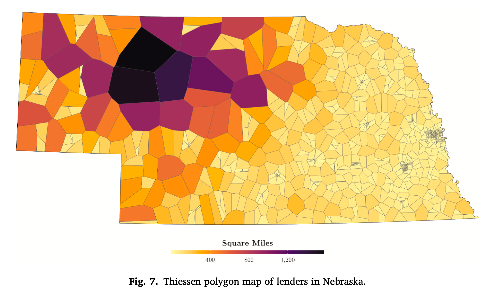
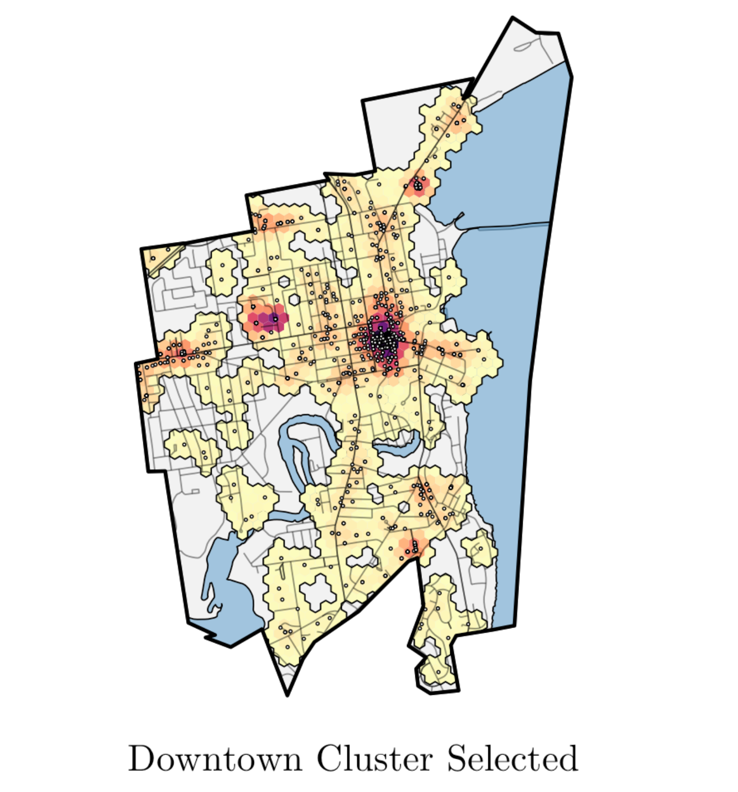
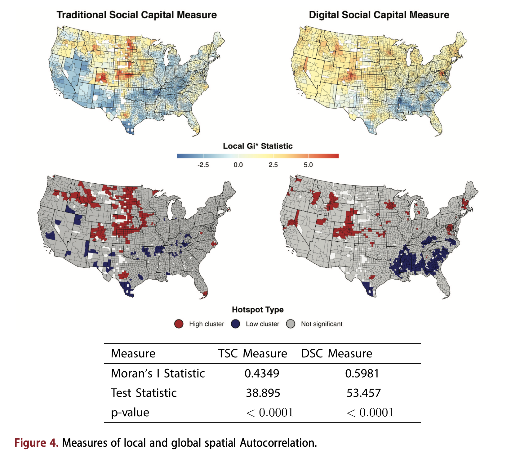
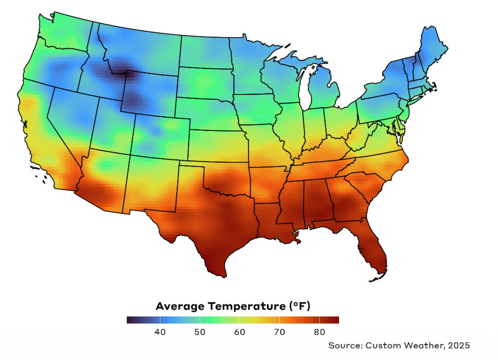
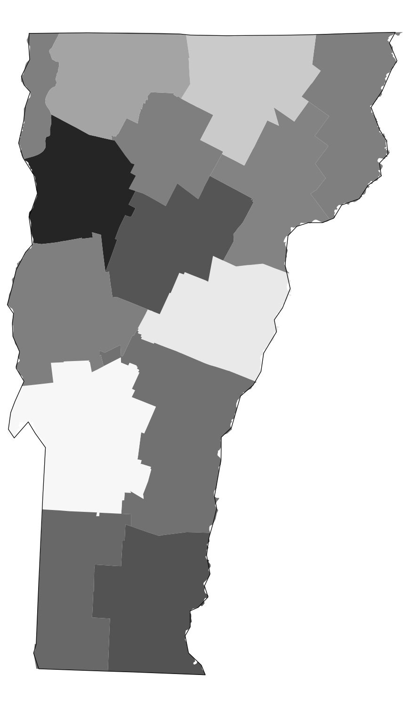
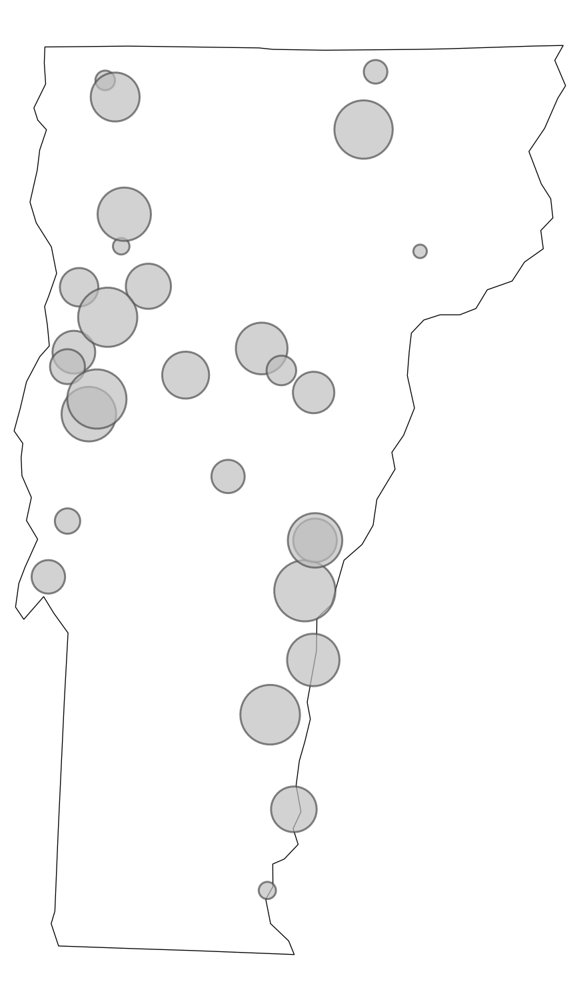
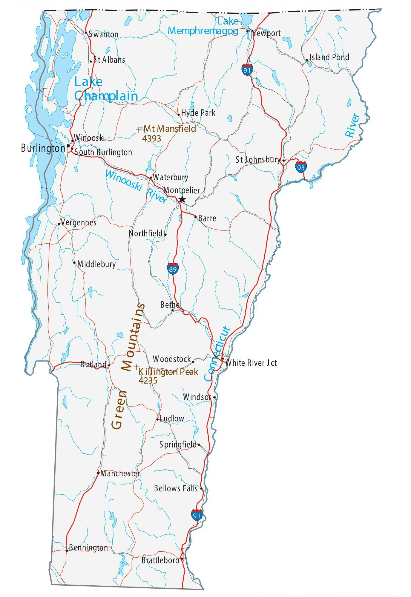
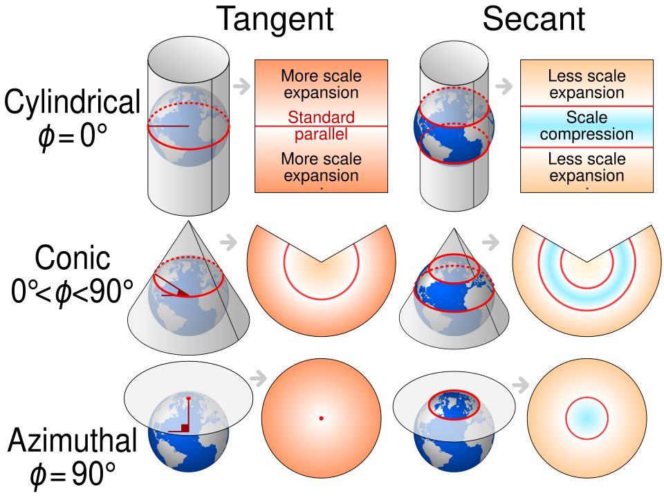
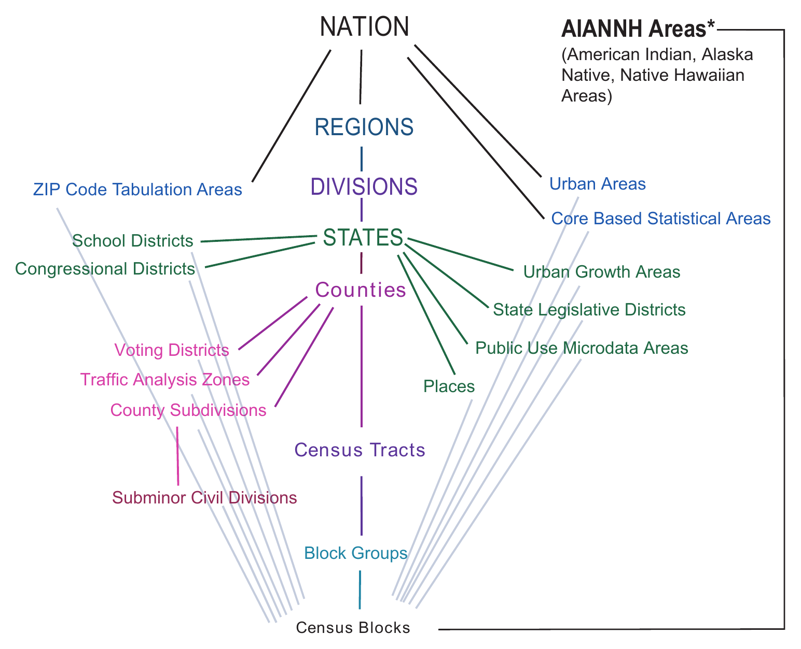

<!-- FIRST DRAFT (Oct 28). Every number on these slides was checked against the 2020-2024 ACS before rendering. -->

```{r}
#| include: false
library(tidyverse)
library(sf)
library(tigris)
library(tidycensus)
options(tigris_use_cache = TRUE)
options(pillar.print_max = 5, pillar.print_min = 5, width = 72)
wide_margin <- theme(plot.margin = margin(5.5, 22, 5.5, 5.5))
theme_set(theme_gray(base_size = 16) + wide_margin)
knitr::opts_chunk$set(fig.width = 8, fig.height = 4.5, fig.align = "center",
                      dpi = 150, out.width = "85%")
# Complete themes reset the base font size to 11, which is too small on a
# projector. These wrappers keep the slide code clean (a bare theme_void())
# while rendering at the same size as every other figure.
theme_minimal <- function(base_size = 16, ...) ggplot2::theme_minimal(base_size = base_size, ...) + wide_margin
theme_void <- function(base_size = 16, ...) ggplot2::theme_void(base_size = base_size, ...) +
  theme(plot.title.position = "plot", plot.caption.position = "plot",
        plot.margin = margin(5.5, 5.5, 5.5, 5.5))

# Objects for the opening slides, before students have installed their keys
vt_counties <- counties("VT", cb = TRUE)
vt_rent <- get_acs(geography = "county", state = "VT",
                   variables = c(rent = "B25064_001"), year = 2024) |>
  mutate(county = str_remove(NAME, " County, Vermont"))
```

## Welcome Back

- First time in the room since the asynchronous week. Thanks for working through the video.
- Tonight we start the last new unit of the semester: **maps**

## Coming Up {.smaller}

| Date | What |
|---|---|
| **Sun. Nov. 1**, 11:59pm | **HW3 due** |
| **Thu. Nov. 5** | Week 10: point data, spatial joins, and publication-quality maps |
| **Thu. Nov. 12** | **No class** (conference) |
| **Sun. Nov. 15**, 11:59pm | **HW5 due**: the maps problem set, covering tonight and next week |
| **Thu. Nov. 19** | Project workday + peer critique (Preliminary Outputs due) |

: {tbl-colwidths="[30,70]"}

## Today's Plan

- **What is GIS?** Just enough of the big ideas to make maps without getting lost
- **Spatial data in R**: `sf` objects, boundary files from `tigris`, and coordinate reference systems
- **Census geography**: how counties, tracts, and block groups fit together
- **`tidycensus`**: install your API key, find variables, and pull ACS data
- **Choropleth maps**: from a raw `geom_sf()` to a map you'd hand to NBRC
- **Your Turn**: a map for your team's domain area

## Follow Along

- Open your **cdae7990_workspace** project in Posit Cloud
- Make a new script: **File → New File → R Script**, and save it as `week09.R`
- Run these lines at the top. If any `library()` call errors, run `source("setup.R")` and try again.

```{r}
#| eval: false
library(tidyverse)
library(sf)
library(tigris)
library(tidycensus)
options(tigris_use_cache = TRUE)
```

- `tigris_use_cache = TRUE` saves every boundary file you download, so the second time you ask for Vermont's counties, R doesn't download them again

# What Is GIS? {background-color="#007155"}

## Same Data, Two Ways

:::: {.columns}

::: {.column width="40%"}
::: {style="font-size: 0.55em;"}
```{r}
#| echo: false
vt_rent |>
  arrange(desc(estimate)) |>
  transmute(County = county, `Median rent` = scales::label_dollar()(estimate)) |>
  knitr::kable()
```
:::
:::

::: {.column width="60%"}
```{r}
#| echo: false
#| fig-width: 5
#| fig-height: 6.5
#| out-width: "100%"
vt_counties |>
  left_join(vt_rent, by = "GEOID") |>
  ggplot(aes(fill = estimate)) +
  geom_sf(color = "white") +
  scale_fill_distiller(palette = "Greens", direction = 1,
                       labels = scales::label_dollar(), name = "Median\nrent") +
  theme_void()
```
:::

::::

::: {.notes}
Same 14 numbers on both sides: median gross rent by Vermont county, 2020-2024 ACS. The table tells you Chittenden is highest. The map tells you that rent is highest around Burlington and the Champlain Islands and lowest in the Northeast Kingdom, which is a geographic story the table hides.
:::

## What Is GIS?

- **Geographic Information Systems**: tools for storing, analyzing, and mapping data that has a location attached
- Any dataset with a "where" can go on a map: counties, towns, addresses, roads, watersheds
- Your NBRC project is inherently spatial: four states, a lot of rural counties, and questions about who has access to what and where
- GIS used to mean desktop software (ArcGIS, QGIS) and a lot of pointing and clicking. R now does most of what those programs do, in a script you can rerun.
- Tonight we learn the GIS ideas we need, when we need them. That's also how Kyle Walker's book handles it: no big theory chapter, just concepts as they come up.

## What Maps Can Do

<!-- Recycled from the AAEA webinar's closing gallery. Talk through where each one comes from. -->

::: {layout-ncol=3}
{fig-alt="Thiessen polygon map of lenders in Nebraska, shaded by square miles, with very large polygons in the sparsely populated northwest"}

{fig-alt="Map of a city with hexagons showing a selected downtown cluster"}

{fig-alt="Four US county maps comparing traditional and digital social capital, with hot spot clusters"}
:::

## Four Ideas for Tonight

1. **Vector data**: points, lines, and polygons
2. **`sf` objects**: a data frame with a geometry column
3. **Coordinate reference systems**: how a round earth becomes a flat map
4. **Census geography**: the nested units that Census data come in

## Vector Data: Points, Lines, Polygons

```{r}
#| echo: false
#| layout-ncol: 3
#| fig-width: 3.5
#| fig-height: 4.2
#| out-width: "80%"
vt_places <- places("VT", cb = TRUE) |> st_centroid()
vt_roads <- primary_secondary_roads("VT")
vt_outline <- st_union(vt_counties)

ggplot() +
  geom_sf(data = vt_outline, fill = "gray95", color = "gray60") +
  geom_sf(data = vt_places, size = 0.8, color = "#007155") +
  labs(title = "Points: Census places") +
  theme_void(base_size = 14)

ggplot() +
  geom_sf(data = vt_outline, fill = "gray95", color = "gray60") +
  geom_sf(data = vt_roads, linewidth = 0.4, color = "#007155") +
  labs(title = "Lines: major roads") +
  theme_void(base_size = 14)

ggplot() +
  geom_sf(data = vt_counties, fill = "#007155", color = "white") +
  labs(title = "Polygons: counties") +
  theme_void(base_size = 14)
```

- Almost everything you'll use for NBRC is vector data. County statistics are polygons. A list of clinics, hospitals, or housing projects with addresses is points.

## Raster Data: A Grid of Cells

:::: {.columns}

::: {.column width="45%"}
- A raster is a grid of cells, each holding a value, like the pixels in a photo
- Think elevation, land cover, satellite imagery, temperature, precipitation
- R handles rasters with the `terra` package, which is already in your workspace
- We won't use rasters in this class, but you'll see them in research on climate, agriculture, and land use
:::

::: {.column width="55%"}
{fig-alt="Map of the contiguous United States showing average temperature as a smooth color gradient from blue in the north to red in the south"}
:::

::::

## Four Kinds of Maps

::: {layout-ncol=4}
{fig-alt="Vermont counties shaded in grays"}

{fig-alt="Outline of Vermont with black dots"}

{fig-alt="Outline of Vermont with gray circles of different sizes"}

{fig-alt="Reference map of Vermont with towns, highways, rivers, and Lake Champlain"}
:::

- **Choropleth**: areas shaded by a value. **Dot map**: one dot per thing. **Proportional symbol**: size shows quantity. **Reference**: shows where things are.
- Tonight is all choropleths. Next week adds points and symbols.

# Spatial Data in R {background-color="#007155"}

## Boundary Files with `tigris`

- **TIGER/Line** files are the Census Bureau's official boundaries: states, counties, tracts, roads, water, and more
- The `tigris` package downloads them straight into R

```{r}
vt_counties <- counties("VT", cb = TRUE)
```

- Behind the scenes this is a **shapefile**, the most common file format for GIS data. You'll read shapefiles you download yourself next week.
- `cb = TRUE` asks for the simplified *cartographic boundary* version. More on that in a minute.

## What's Inside an `sf` Object? {.smaller}

```{r}
vt_counties |>
  select(GEOID, NAME, ALAND)
```

- It's a data frame with one extra column, `geometry`, that holds the shape of each county
- The header tells you the geometry type (MULTIPOLYGON), the bounding box, and the **CRS** (NAD83)
- Because it's a data frame, `filter()`, `mutate()`, `select()`, and `left_join()` all work exactly the way you already know

## Your First Map

```{r}
#| fig-height: 5.5
#| out-width: "55%"
ggplot(vt_counties) +
  geom_sf()
```

- `geom_sf()` reads the `geometry` column for you. No `aes(x, y)` needed.

## Cartographic Boundaries vs. TIGER/Line

```{r}
#| echo: false
#| layout-ncol: 2
#| fig-width: 4
#| fig-height: 4.6
#| out-width: "80%"
vt_counties_full <- counties("VT", cb = FALSE)

# Zoom to a stretch of the Connecticut River, where Windsor County meets NH
river_zoom <- coord_sf(xlim = c(-72.48, -72.36), ylim = c(43.45, 43.62))
n_points <- function(x) scales::label_comma()(nrow(st_coordinates(x)))

ggplot(vt_counties_full) +
  geom_sf(fill = "#007155", color = "white", linewidth = 0.6) +
  river_zoom +
  labs(title = paste0('cb = FALSE: ', n_points(vt_counties_full), ' points')) +
  theme_void(base_size = 14) +
  theme(panel.border = element_rect(fill = NA, color = "gray60"))

ggplot(vt_counties) +
  geom_sf(fill = "#007155", color = "white", linewidth = 0.6) +
  river_zoom +
  labs(title = paste0('cb = TRUE: ', n_points(vt_counties), ' points')) +
  theme_void(base_size = 14) +
  theme(panel.border = element_rect(fill = NA, color = "gray60"))
```

::: {style="font-size: 0.6em; text-align: center;"}
Zoomed in on the Connecticut River, where Windsor County meets New Hampshire. The point counts are for all 14 Vermont counties.
:::

## Cartographic Boundaries vs. TIGER/Line

- Both files describe the same 14 counties. The cartographic boundary version (`cb = TRUE`) is **simplified**, so it traces each border with far fewer points.
- At the scale of a statewide or national map you can't see the difference, and the smaller file downloads and draws faster
- In some places cb files are also clipped to the shoreline. Walker shows this for Michigan, where the TIGER/Line counties extend out into the Great Lakes.
- **Rule of thumb**: use `cb = TRUE` for any map

## Coordinate Reference Systems

:::: {.columns}

::: {.column width="45%"}
- The earth is round. Maps are flat. Something has to give.
- A **coordinate reference system (CRS)** says how a point on the round earth lands on a flat map
- Every projection distorts something: area, shape, distance, or direction. You choose what to protect.
:::

::: {.column width="55%"}
{fig-alt="Diagram comparing cylindrical, conic, and azimuthal map projections, showing how each wraps a flat surface around a globe"}
:::

::::

::: {style="font-size: 0.5em;"}
"Comparison of cartography surface development" by cmglee et al., [CC BY-SA 4.0](https://creativecommons.org/licenses/by-sa/4.0/), via Wikimedia Commons
:::

## The Same States, Two CRSs

```{r}
#| layout-ncol: 2
#| fig-width: 6
#| fig-height: 3.5
#| out-width: "100%"
lower48 <- states(cb = TRUE, resolution = "20m") |>
  filter(!STUSPS %in% c("AK", "HI", "PR"))

ggplot(lower48) +
  geom_sf()

ggplot(lower48) +
  geom_sf() +
  coord_sf(crs = 5070)
```

- `coord_sf(crs = 5070)` reprojects the map as it's drawn, without changing your data. The US looks like the US again.

## The Three CRSs You'll Actually See {.smaller}

| CRS | EPSG code | Where you'll see it |
|---|---|---|
| NAD83 | 4269 | Everything from the Census Bureau (`tigris`, `tidycensus`) |
| WGS84 | 4326 | GPS coordinates, latitude/longitude columns, web maps |
| Albers Equal Area | 5070 | Static maps of the US or a multi-state region |

: {tbl-colwidths="[25,15,60]"}

- An **EPSG code** is just an ID number for a CRS. It's what you hand to R.
- Check a layer's CRS with `st_crs(vt_counties)`, and change it for good with `st_transform(vt_counties, 5070)`
- **If two layers don't line up, check the CRS first.** It's the most common beginner problem in GIS, and next week we'll combine layers from different sources.

## Break? {background-color="#007155"}

# Census Geography {background-color="#007155"}

## The Census Hierarchy

{fig-align="center" height="560" fig-alt="Census Bureau diagram of the standard hierarchy of geographic entities, running from nation through regions, divisions, states, counties, census tracts, and block groups down to census blocks, with other geographies such as ZIP Code Tabulation Areas, places, and school districts branching off"}

::: {style="font-size: 0.5em;"}
Source: US Census Bureau, [Standard Hierarchy of Census Geographic Entities](https://www2.census.gov/geo/pdfs/reference/geodiagram.pdf)
:::

## The Spine: State → County → Tract → Block Group

- The center line of that diagram is the one you'll use most. Each level nests perfectly inside the one above it.
- **Tracts** are drawn to hold roughly 4,000 people, so they're small in cities and huge in rural areas
- **Block groups** are pieces of tracts. They're the smallest units the ACS reports.
- Some geographies don't nest at all. A ZIP code (ZCTA) can cross county and even state lines.

## Nesting in Chittenden County

```{r}
#| echo: false
#| layout-ncol: 3
#| fig-width: 3.5
#| fig-height: 4.5
#| out-width: "100%"
chittenden <- vt_counties |> filter(NAME == "Chittenden")
chittenden_tracts <- tracts("VT", county = "Chittenden", cb = TRUE)
chittenden_bgs <- block_groups("VT", county = "Chittenden", cb = TRUE)

ggplot(chittenden) +
  geom_sf(fill = "#007155", color = "white") +
  labs(title = "1 county") +
  theme_void(base_size = 14)

ggplot(chittenden_tracts) +
  geom_sf(fill = "#007155", color = "white") +
  labs(title = paste(nrow(chittenden_tracts), "tracts")) +
  theme_void(base_size = 14)

ggplot(chittenden_bgs) +
  geom_sf(fill = "#007155", color = "white", linewidth = 0.2) +
  labs(title = paste(nrow(chittenden_bgs), "block groups")) +
  theme_void(base_size = 14)
```

```{r}
#| eval: false
chittenden_tracts <- tracts("VT", county = "Chittenden", cb = TRUE)
chittenden_bgs <- block_groups("VT", county = "Chittenden", cb = TRUE)
```

- Statewide, Vermont has 14 counties, 193 tracts, and 552 block groups

## Every Unit Has a GEOID {.smaller}

- The **GEOID** is the ID that every Census dataset shares, and it's your join key. It builds up one level at a time.

| Level | GEOID | Digits |
|---|---|---|
| State (Vermont) | `50` | 2 |
| County (Chittenden) | `50` `007` | 2 + 3 |
| Tract (Census Tract 9) | `50` `007` `000900` | 2 + 3 + 6 |
| Block group 1 | `50` `007` `000900` `1` | 2 + 3 + 6 + 1 |

: {tbl-colwidths="[38,37,25]"}

- GEOIDs are text, not numbers. Read Autauga County, Alabama (`01001`) in as a number and it becomes `1001`, which won't join to anything.

# `tidycensus` {background-color="#007155"}

## Install Your Census API Key (Together)

1. Find the email from the Census Bureau, and make sure you clicked its activation link
2. In the **Console** (not in your script), run this with your own key pasted in:

```{r}
#| eval: false
census_api_key("PASTE-YOUR-KEY-HERE", install = TRUE)
```

3. Restart R: **Session → Restart R**
4. Check that it worked. This should print your key.

```{r}
#| eval: false
Sys.getenv("CENSUS_API_KEY")
```

## Why the Console?

- Your API key is like a password. It shouldn't sit in a script or `.qmd` you email to me or publish later.
- `install = TRUE` saves it to a hidden file in your project (`.Renviron`) that R reads every time it starts, so you only do this once
- If R says a key already exists, run the same line again with `overwrite = TRUE` added

## Two Big Census Products {.smaller}

| | Decennial Census | American Community Survey (ACS) |
|---|---|---|
| **How often** | Every 10 years (2020 is the latest) | Every year |
| **Who** | Everyone | A sample of households |
| **What** | A few questions: age, sex, race, ethnicity, housing tenure | Much more: income, rent, home value, commuting, education, internet access |
| **Numbers** | Counts | Estimates, each with a margin of error |
| **In R** | `get_decennial()` | `get_acs()` |

: {tbl-colwidths="[16,38,46]"}

- Almost everything you'll want for NBRC (rent, income, broadband, commuting) comes from the ACS

## 1-Year vs. 5-Year ACS

- The **1-year ACS** only covers places with 65,000 or more people
- The **5-year ACS** pools five years of responses, so it covers every county, tract, and block group
- How many Vermont counties have 1-year data?

```{r}
vt_acs1 <- get_acs(geography = "county", state = "VT", survey = "acs1",
                   variables = "B01003_001", year = 2024)
vt_acs1
```

- Only Chittenden. For rural work, you'll almost always use the 5-year ACS, which is `get_acs()`'s default.

## Finding Variables {.smaller}

```{r}
acs_vars <- load_variables(2024, "acs5")

acs_vars |>
  filter(str_detect(label, "Median gross rent")) |>
  select(name, label)
```

- There are over 28,000 variables. In RStudio, `View(acs_vars)` gives you a search box.
- A name like `B25064_001` means **table** B25064, **line** 001
- [Census Reporter](https://censusreporter.org) is a friendlier way to browse tables before you come back to R

## Your First `get_acs()` Call

```{r}
vt_rent <- get_acs(
  geography = "county",
  state = "VT",
  variables = c(rent = "B25064_001"),
  year = 2024
)
vt_rent
```

- Naming the variable (`rent = ...`) makes the `variable` column readable
- Every ACS row has an **estimate** and a **moe** (margin of error)

## Margins of Error Are Real

```{r}
#| output-location: slide
#| fig-height: 5.5
#| out-width: "75%"
vt_rent_plot <- vt_rent |>
  mutate(county = str_remove(NAME, " County, Vermont"))

ggplot(vt_rent_plot, aes(x = estimate, y = fct_reorder(county, estimate))) +
  geom_errorbar(aes(xmin = estimate - moe, xmax = estimate + moe), width = 0.3) +
  geom_point(size = 3, color = "#007155") +
  scale_x_continuous(labels = scales::label_dollar()) +
  labs(title = "Median gross rent, Vermont counties",
       subtitle = "2020-2024 ACS 5-year estimates, with margins of error",
       x = NULL, y = NULL) +
  theme_minimal()
```

## Margins of Error Are Real

- Chittenden's estimate is $1,646 ± $31. Essex County's is $827 ± $114.
- Smaller populations mean fewer survey responses and wider margins
- Across Vermont, the typical county margin is about 5% of its estimate. For tracts it's about 15%.
- This is the same figure Walker builds for Maine in Chapter 4 of the reading
- **For NBRC**: when two rural counties look different, check that their margins don't overlap before you say so

## Wide Output

```{r}
vt_tenure <- get_acs(
  geography = "county",
  state = "VT",
  variables = c(total = "B25003_001", renter = "B25003_003"),
  year = 2024,
  output = "wide"
)
vt_tenure
```

- `output = "wide"` gives one row per county, with an `E` (estimate) and `M` (margin) column for each variable
- Wide is easier when you need to divide one variable by another, which is next

# Choropleth Maps {background-color="#007155"}

## Data + Geometry in One Call

```{r}
vt_home_value <- get_acs(
  geography = "tract",
  state = "VT",
  variables = c(home_value = "B25077_001"),
  year = 2024,
  geometry = TRUE
)
```

- `geometry = TRUE` asks `tidycensus` to fetch the matching `tigris` boundaries and join them for you
- You get back an `sf` object, ready for `geom_sf()`
- Changing `geography = "tract"` to `"county"` or `"block group"` is the only edit you need to change the scale

## Step 1: Just Map It

```{r}
#| fig-height: 5.5
#| out-width: "60%"
ggplot(vt_home_value) +
  geom_sf(aes(fill = estimate))
```

## Step 2: Make It Readable

```{r}
#| output-location: slide
#| fig-height: 5.5
#| out-width: "75%"
ggplot(vt_home_value) +
  geom_sf(aes(fill = estimate), color = "white", linewidth = 0.1) +
  scale_fill_viridis_c(labels = scales::label_dollar(),
                       na.value = "gray85",
                       name = "Median\nhome value") +
  theme_void() +
  labs(title = "10 of Vermont's 15 priciest tracts\nare in Chittenden County",
       caption = "Source: 2020-2024 ACS 5-year estimates, table B25077")
```

## What Changed

- `color = "white", linewidth = 0.1`: thin borders that separate tracts without shouting
- `scale_fill_viridis_c()`: a sequential palette that reads well in grayscale and for colorblind viewers
- `na.value = "gray85"`: one tract has no estimate. Gray says "no data" instead of hiding it.
- `theme_void()`: drops the axes and grid. Latitude and longitude tick marks almost never help a reader.
- A title that states the finding, and a caption that names the source (Week 8's storytelling rules apply to maps too)

## Continuous vs. Binned Color

```{r}
#| layout-ncol: 2
#| fig-width: 4.5
#| fig-height: 5
#| out-width: "100%"
ggplot(vt_home_value) +
  geom_sf(aes(fill = estimate), color = NA) +
  scale_fill_viridis_c(labels = scales::label_dollar(), name = NULL) +
  theme_void()

ggplot(vt_home_value) +
  geom_sf(aes(fill = estimate), color = NA) +
  scale_fill_viridis_b(labels = scales::label_dollar(), name = NULL, n.breaks = 6) +
  theme_void()
```

## Continuous vs. Binned Color

- A **continuous** scale (`_c`) gives every value its own shade. It's honest, but readers can't tell two shades apart.
- A **binned** scale (`_b`) groups values into a few classes. It's easier to read, but where you put the breaks changes the story.
- Walker's Chapter 6 compares classification methods (equal intervals, quantiles, natural breaks) if you want to go deeper
- ColorBrewer's palettes work here too: `scale_fill_distiller()` for continuous and `scale_fill_fermenter()` for binned

## Counts vs. Rates

```{r}
#| layout-ncol: 2
#| fig-width: 4.5
#| fig-height: 5
#| out-width: "100%"
vt_tenure_sf <- vt_counties |>
  left_join(vt_tenure, by = "GEOID") |>
  mutate(renter_share = renterE / totalE)

ggplot(vt_tenure_sf) +
  geom_sf(aes(fill = renterE), color = "white") +
  scale_fill_distiller(palette = "Purples", direction = 1,
                       labels = scales::label_comma(), name = NULL) +
  labs(title = "Renter households") +
  theme_void()

ggplot(vt_tenure_sf) +
  geom_sf(aes(fill = renter_share), color = "white") +
  scale_fill_distiller(palette = "Purples", direction = 1,
                       labels = scales::label_percent(), name = NULL) +
  labs(title = "Share of households renting") +
  theme_void()
```

## Counts vs. Rates

- A map of raw counts is mostly a map of where people live. Chittenden wins every count map.
- Divide by the right denominator: renters out of all households, seasonal homes out of all housing units
- Lamoille County has fewer than 3,300 renter households, but it has the second-highest renter share in the state
- **Choropleths should almost always show a rate, share, or median**, not a raw count. Next week we'll see better ways to show counts.

## Scaling Up: The NBRC States

```{r}
#| output-location: slide
#| fig-height: 5.5
#| out-width: "85%"
nbrc_states <- c("ME", "NH", "NY", "VT")

seasonal <- get_acs(
  geography = "county",
  state = nbrc_states,
  variables = c(seasonal = "B25004_006", units = "B25001_001"),
  year = 2024,
  output = "wide",
  geometry = TRUE
) |>
  mutate(seasonal_share = seasonalE / unitsE)

state_lines <- states(cb = TRUE) |>
  filter(STUSPS %in% nbrc_states)

ggplot(seasonal) +
  geom_sf(aes(fill = seasonal_share), color = "white", linewidth = 0.1) +
  geom_sf(data = state_lines, fill = NA, color = "black", linewidth = 0.4) +
  coord_sf(crs = 5070) +
  scale_fill_distiller(palette = "YlGnBu", direction = 1,
                       labels = scales::label_percent(), name = NULL) +
  theme_void() +
  labs(title = "In some rural counties, a third\nor more of homes are seasonal",
       subtitle = "Share of housing units held for seasonal,\nrecreational, or occasional use",
       caption = "Source: 2020-2024 ACS 5-year estimates, tables B25004 and B25001")
```

## What's New Here

- `state = c("ME", "NH", "NY", "VT")` pulls four states in one call
- A second `geom_sf()` layer with `fill = NA` draws state outlines on top. Layers stack in the order you add them.
- `coord_sf(crs = 5070)` makes a four-state map look right
- Hamilton County, NY tops the region at 65% seasonal units. Grand Isle and Essex, VT are both above a third.
- NBRC's service area is a subset of the counties in these states, so we'll trim this down when we get to your projects

# Your Turn {background-color="#007155"}

## Your Turn (30 min) {.smaller}

Work with your team. Pick **one** NBRC state.

1. Find an ACS variable that fits your domain area. Some starting points:
   - **Rural Housing**: rent burden (B25070), year built (B25034), vacancy (B25004)
   - **Rural Hub Services**: internet access (B28002)
2. Pull it with `get_acs()` for your state's **counties**, with `geometry = TRUE`
3. Turn it into a share, not a count. You'll need the table's total line (usually `_001`) as the denominator.
4. Make a choropleth with a readable palette, `theme_void()`, a title that states what you see, and a source caption
5. Change `geography` to `"tract"`. Does the story change?
6. Look at your margins of error. Is any part of your story shakier than you'd like?

## Your Turn: One Way to Do It {.smaller}

```{r}
#| output-location: slide
#| fig-height: 5.5
#| out-width: "70%"
me_internet <- get_acs(
  geography = "county",
  state = "ME",
  variables = c(total = "B28002_001", no_internet = "B28002_013"),
  year = 2024,
  output = "wide",
  geometry = TRUE
) |>
  mutate(no_internet_share = no_internetE / totalE)

ggplot(me_internet) +
  geom_sf(aes(fill = no_internet_share), color = "white") +
  scale_fill_distiller(palette = "OrRd", direction = 1,
                       labels = scales::label_percent(), name = NULL) +
  theme_void() +
  labs(title = "Nearly 12% of households in\nAroostook and Washington counties\nhave no internet access",
       caption = "Source: 2020-2024 ACS 5-year estimates, table B28002")
```

## Before Next Class (Nov. 5) {.smaller}

- [ ] **HW3** is due **Sunday, Nov. 1** at 11:59pm
- [ ] **Reading**: [*Spatial Data Science*](https://r-spatial.org/book/), skim Chapters 1-3
- [ ] Keep your `week09.R` script. Next week builds on it.
- [ ] **Next week**: point data (turning a spreadsheet of addresses or coordinates into a map), spatial joins, and the finishing touches that make a map publication-ready (scale bars, north arrows, insets)

## Thank you! {background-color="#007155"}
