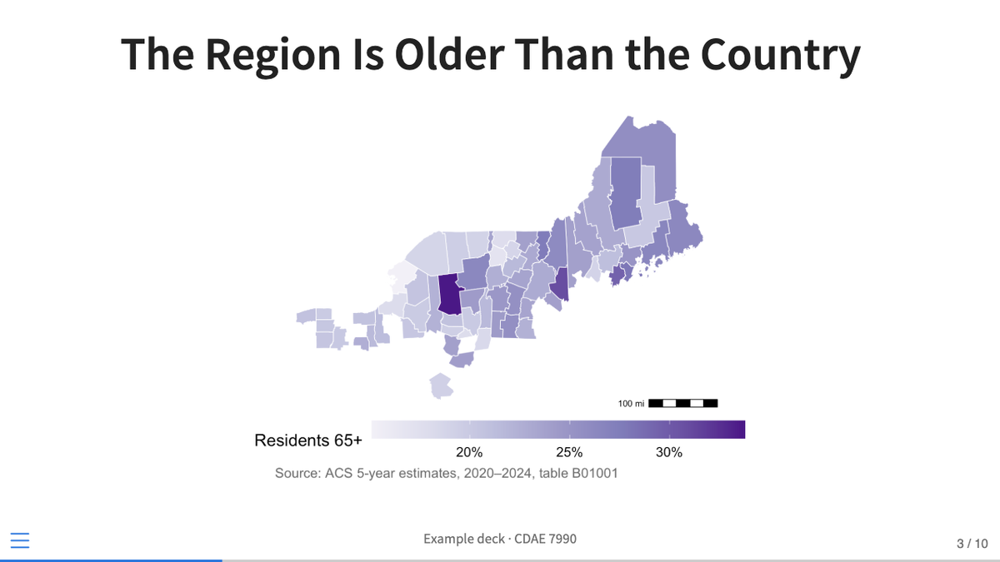
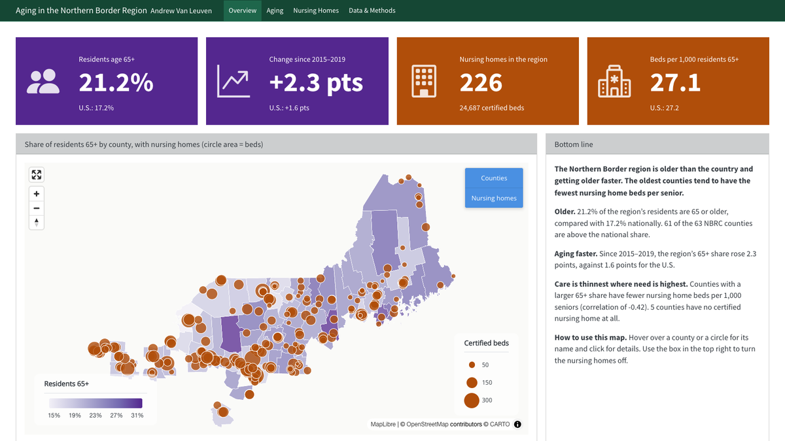

## Today's Plan {.smaller}

| Time (approx.) | What |
|---|---|
| 4:35 | Welcome, today's plan, and the example deliverables |
| 4:45 | **Presentation 1:** one team presents, then feedback |
| 5:10 | **Presentation 2:** the other team presents, then feedback |
| 5:35 | Break |
| 5:45 | **One-on-one meetings:** I meet with each team |
| ~6:30 | Done |

: {tbl-colwidths="[20,80]"}

- Today is the **Preliminary Outputs + Peer Critique** milestone (20% of the project grade)

## Example Deliverables {.smallest}

:::: {.columns}

::: {.column width="50%"}
[{fig-alt="Preview of the example slide deck"}](../examples/index.html)

**Slide deck:** you tell the story, one figure per slide
:::

::: {.column width="50%"}
[{fig-alt="Preview of the example dashboard"}](../examples/index.html)

**Dashboard:** the page tells the story on its own
:::

::::

- Same data, same story, two formats: **[andrewvanleuven.github.io/uvm_datasci/examples](../examples/index.html)** (also linked from the Project page)
- Each one has a "Read the code" link. Most of it is code we've already written in class.

## How the Presentations Work {.smaller}

Each team presents to me and the other team. About 25 minutes per team:

1. **Present (about 10 min).** Your bottom line in one sentence, your figure(s), and why it matters to NBRC.
2. **Clarifying questions (about 5 min).** Quick factual questions only ("What's the unit?" "Which years?").
3. **Feedback (about 10 min).** First from the other team, then from me.

- **While presenting:** listen, take notes, and don't worry about defending every choice
- **Before you sit down:** write down your team's top 3 changes for the December 3 draft

## Giving Useful Feedback {.smallest}

- **What do you see?** Can you say the takeaway in one sentence? Does it match theirs?
- **Is the title a finding or a label?** "Rent burden by county" is a label. "Nearly half of renters in Addison County pay more than 30% of income on rent" is a finding.
- **One figure, one message?** If it takes two sentences to explain, it might be two figures.
- **Are we being tricked?** Look at the axes, the scales, and the color choices.
- **What's missing?** A source, a benchmark (the state or the U.S.), a comparison over time?
- **For maps:** a rate or share rather than a raw count? The right geography? A scale bar?
- **Why would NBRC care?** Could a busy commissioner say what decision this informs?

Specific beats general: "the color scale hides the low end" helps more than "looks good."

## How Today Is Graded {.smaller}

- **One grade per team**, 20% of the project grade
- Graded on **effort and communication quality**, not on finished analysis

| Criterion | What I'm looking for |
|---|---|
| **Output** | At least one polished chart or map built in R (`ggplot2`/`sf`) that addresses one of your research questions |
| **Framing** | You can say what it shows and why it matters to NBRC, in plain language |
| **Feedback** | You give specific, usable feedback to the other team and take theirs on board |

: {tbl-colwidths="[20,80]"}

## One-on-One Meetings {.smaller}

After both presentations, I'll meet with **each team as a group** for about 20 minutes to:

- Answer your questions
- Give you my own feedback on today's output
- Agree on your top 3 changes for the December 3 draft
- Confirm your format: **slide deck or dashboard**
- Work through any code or data roadblocks
- Check in on how the work is divided between now and December 17

While the other team meets with me, start on your revisions.

## The Rest of the Semester {.smaller}

| Date | What |
|---|---|
| **Nov 26** | No class (Thanksgiving) |
| **Dec 3** (Week 14) | **Draft Deliverable + Revision due** (20%): a near-complete deck or dashboard. In-class feedback and revision. |
| **Dec 10** (Week 15) | Final polish, presentation prep, and semester wrap-up |
| **Dec 17** (Week 16) | **Field trip to Montpelier:** final presentations to NBRC (20%) |

: {tbl-colwidths="[28,72]"}

- For the most part, class will end **closer to 6:00–6:30** than the full three hours
- Questions between classes? **Email me or send me a message on Teams** anytime.

## Thank you! {background-color="#007155"}
